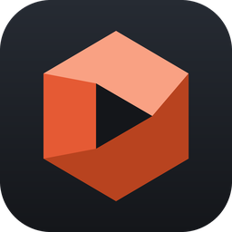
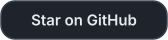
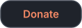
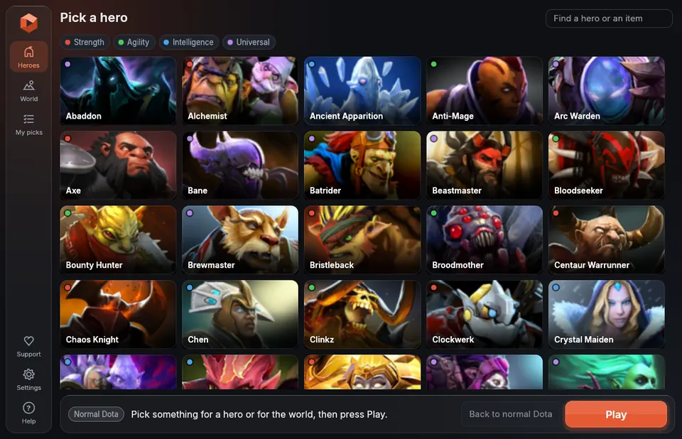
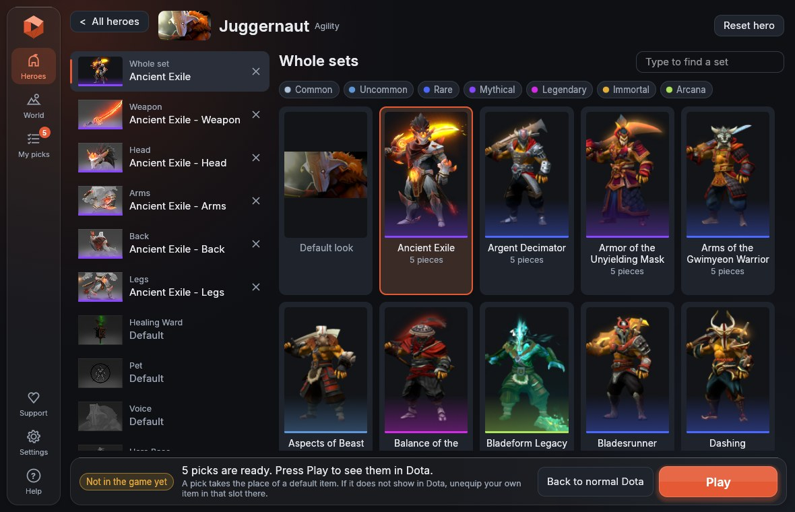
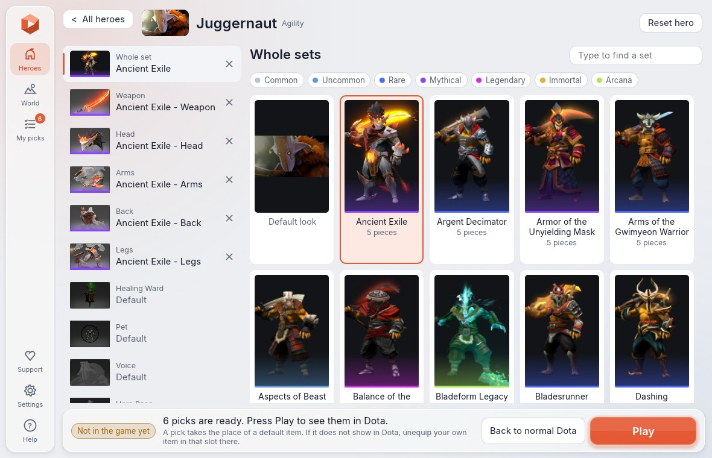

<p align="center"></p>

<h1 align="center">Dota 2 Mod Enjoyer</h1>

<p align="center">Pick what your heroes and your game look like, press Play, and Dota starts that way.<br>Only you see the result.</p>

<p align="center">
  <a href="https://github.com/elangrr/Dota2ModEnjoyer/releases/latest/download/Dota2ModEnjoyer.exe"></a>
</p>

<p align="center">
  <a href="https://github.com/elangrr/Dota2ModEnjoyer"></a>
  &nbsp;
  <a href="#supporting-the-project"></a>
</p>

<p align="center"></p>

> **Use at your own risk.** This tool edits two of Dota 2's own files. That may break Valve's terms
> of service. It is not affiliated with Valve.

## Quick start

1. Press the download button above. You get `Dota2ModEnjoyer.exe`, which is one file and needs
   no installing. Older versions are on the
   [releases page](https://github.com/elangrr/Dota2ModEnjoyer/releases).
2. Close Dota 2 if it is open, and start the app. It finds Dota 2 by itself.
3. Choose a hero and click what you want it to wear.
4. Press **Play**.

Windows may warn about a program it has not seen before, because the file is not signed with a
paid certificate.

## What it looks like

| | |
|---|---|
|  |  |
| Every hero, with search and filters | A whole set in one click, or piece by piece |

The app has a night look and a day look.



## Where to read

| You want to | Read |
|---|---|
| Change how a hero looks | [Heroes](#heroes) |
| Change the courier, ward, terrain or music | [World](#world) |
| Add glows, teleport and attack effects | [Effects](#effects) |
| Know why something does not show | [When something does not show](#when-something-does-not-show) |
| Undo everything | [Going back to normal Dota](#going-back-to-normal-dota) |
| Know what the tool does to your game | [What it changes](#what-it-changes) |
| Use the command line | [The command-line tool](#the-command-line-tool) |
| Build it or work on the code | [Building](#building) |
| Help the project | [Supporting the project](#supporting-the-project) |
| Get a quick answer | [Questions and answers](#questions-and-answers) |

## Using the app

The app reads the heroes, items, names and pictures from your own game. Your picks are
remembered. After a Dota 2 update, press Play as usual and they are put back.

### Heroes

Under **Heroes**, choose a hero. Then pick a whole set, or go slot by slot and mix pieces.

To search, just type. There is no need to click the search box first. Heroes are found by the
short names Dota itself knows them by, such as `am`, `wr`, `qop`. From the third letter on, items
and sets are found too, wherever they are, so typing `dragonclaw` takes you straight to the
hook. Enter opens the first thing found, Escape clears what you typed.

The chips above the heroes show only Strength, Agility, Intelligence or Universal heroes, or
only the heroes you picked something for.

Rest the pointer on an item or a set for a larger picture of it, with its styles side by side.

The line under a picture has the colour of the item's rarity, as in Dota: purple for mythical,
gold for immortal and so on. The buttons above the pictures show only the rarities you choose.

### My picks and presets

The **My picks** tab lists everything you picked, for the world and for each hero. A click on a
pick opens its page, and the cross beside it takes it off.

You can keep what is picked as a preset. Type a name on that page and press "Save as preset".
A click on a preset picks it again later, in the place of what is picked then, and Undo takes
that back.

### Ability effects

Under what a hero wears, its page lists the abilities that items have effects for, such as "Blade
Fury effects". Pick an item there and the ability gets that item's effects, icon and sounds,
whatever the hero wears, so a plain sword can have an immortal sword's Blade Fury. Only effects
that Dota itself lets players use apart from their item are listed, which is most immortals' and a
few others'.

### Personas

A persona you pick is put on the hero's own items, so it shows without your owning it in Dota. It
takes the place of what the hero wears: picks for those slots are taken off, and you can still
pick for the persona's own slots. Personas are an experiment.

### World

Under **World** are the courier, ward, terrain, announcers, music and the rest. They work the same
way as a hero's slots.

### Effects

There are two kinds.

An effect on one item. Once you have picked a courier, or something a hero wears, the **Effect**
list above the pictures puts one more effect on it, the way a gem does in Dota: Ethereal Flame and
42 others. On a hero, the eight seasonal ones (Frostbloom, Snowdrift ...) are made for it. The 35
marked "(courier)" are made for couriers and are an experiment there.

Effects from past events. These are on the World page, under "Effects". They are what events gave
the players who took part.

- Emblem puts the glow of an event's emblem around your heroes. It rides on one slot of each
  hero. For about half of the heroes that is a slot nothing else can go in, so they always
  show it; the others show it while that slot is on its default item in your Dota loadout.
- For Teleport, Blink Dagger, Attack, Force Staff, Eul's Scepter, Bottle, level up, the fountain
  and more, pick an event and, where it had several, a level. A hero shows the effect as long as
  one of its slots in your Dota loadout is on its default item.

These go on the heroes you picked something for in the app. A hero with no pick stays plain. In
**Settings** you can have them on every hero, or on heroes you choose. Dota's files cannot tell
your own hero from the others, so anyone in a match who plays one of those heroes shows them
too, on your screen only.

Colours (the Prismatic gems) are gone. In a match, Dota's servers decide what colour a gem has
from what you really own, so a colour never showed there.

### Experiments

Three things are new enough to be marked as experiments. If one misbehaves, turn it off and
everything is as before.

- Trees (World page, at the bottom) puts the leaves of Valve's autumn, winter or spring terrain
  on the trees of the normal map. The trees stay where they are and as large as they are, so
  nothing is made smaller or easier to see through.
- Map Effect (World page, at the bottom) draws the whole map the way one of Valve's events had
  it, such as Diretide's. Aghanim's Labyrinth's is marked "!" because its fog of war can look
  like a checkerboard.
- Low-end PC mode (in **Settings**) makes Play start Dota with its lightest video
  settings: no shadows, simple water and lighting, no fog, grass or other extras. No file is
  written for this. Dota may keep the settings afterwards; you can change them back in Dota's
  video options.

### Settings

**Settings** (bottom left) has which heroes get the effects of events, the look of the app
(Night, Day, or whichever Windows is set to), Low-end PC mode, updates,
and where Dota and your picks are.

### Going back to normal Dota

**Back to normal Dota** takes every change out of the game's files and puts your picks away, so
nothing is picked any more and Play starts normal Dota. **Bring back my picks** picks everything
again as it was. If you pick something new instead, you start over from there.

## When something does not show

- You wear an item of your own in that slot. A pick takes the place of a slot's default item, and
  Dota shows your own item instead. Unequip it in your Dota loadout for the pick to show.
- Ability effects come along with the default item of the slot their item belongs to. An immortal
  sword's show while your Dota loadout has the default weapon. The app names the slot.
- The item has a small "!". A part of it may not show. Either Dota no longer has some of its
  files, or some of its effects go by the level of an arcana, which Dota's servers give only to
  its owner.
- Your video settings are on their lightest. Those leave parts of effects out.
- Dota 2 was running. Nothing is written while it runs. Close the game, then press Play. The app
  can stay open while you play.
- You changed Dota's video settings in the middle of a match. That makes Dota show picked
  heroes as "ERROR" until the next game. Change video settings before a match.

Some things cannot be changed at all, because the game has no default item for them: taunts,
kill banners, effigies, the Tormentor and the Ancient.

Two more things to know. Other players who use the default look show your pick too, on your
screen only. And ten heroes have one default pet between them, so a pet picked for one of them
shows on all ten and only one of them can have a pick there. The app says so on the pet's page.

## Updates

The app updates itself. When a newer version is out, an **Update** button shows on the left.
One click downloads the new version, puts it in the place of the old one and starts it. Picks
and settings stay as they are. The app looks when it starts and, left open, every five minutes.

**Settings** has "Update automatically", which is off by default. Switched on, the app updates
and starts again by itself, without the click.

Versions before 0.1.2 do not look for updates, so get 0.1.2 or later by hand once.

## How it works

Dota 2 already ships its cosmetic items in its own files, because your game has to draw other
players' items. Every slot has a built-in "default item" that the game shows when you have put
nothing there: one per slot of each hero, and one each for the courier, the ward, the terrain and
so on. The tool makes a copy of the game's item list in which the default items of the slots you
picked look like the items you picked, puts that copy in its own folder, and tells the game to look
in that folder first.

Nothing of the game's is downloaded, and none of Valve's files are copied anywhere else.
[docs/SPEC.md](docs/SPEC.md) has the details.

The newest parts have been checked against the game's files and not yet seen in the game:
personas without owning them, courier effects on heroes, emblems, event attacks, and the three
experiments.

## What it changes

| File | Change |
|---|---|
| `game\mod_enjoyer\pak01_dir.vpk` | Created. Holds the edited item list and, if you picked other trees or a map effect, a few small copies of Valve's own material files under other names. |
| `game\dota\gameinfo_branchspecific.gi` | A marked block of lines is added. |
| `game\bin\win64\dota.signatures` | One line is added at the end. |

"Back to normal Dota" (`dme restore`) undoes all three exactly. So does Steam's "Verify integrity
of game files". Copies of the two original files are kept in
`%LOCALAPPDATA%\Dota2ModEnjoyer\backup`, next to your picks and the app's settings.

While your picks are on, Dota keeps a few small files of its own in `game\mod_enjoyer` too: hero
guides it has downloaded and, after a crash, its crash report. Going back to normal removes the
folder with them, and Dota downloads guides again when it needs them. Downloaded replays are
kept where they always are.

The tool refuses to write while Dota 2 is running, and it never touches the running game. To
start the game it asks Steam to.

## The command-line tool

`dme.exe` does what the app does, from a terminal. It is on the same release page. The app and
`dme` share the picks: what you pick in one, the other plays.

### Commands

```
dme status                  where Dota is, whether mods are on, and what is picked
dme heroes                  the heroes, with how many sets and items each has
dme sets axe                the sets of one hero
dme slots axe               the slots of one hero and what it has in each normally
dme items axe weapon        the items that can go in one slot of a hero
dme world                   the slots that are not a hero's: courier, ward, terrain ...
dme items courier           the items that can go in a world slot
dme effects                 the effects that can be put on an item
dme apply <picks>           show the picks in the game, and remember them
dme play                    put the remembered picks in the game if they are not there, start Dota
dme play --low-end          the same, starting Dota with its lightest video settings (an experiment)
dme restore                 back to normal Dota; the picks are put away until dme play
dme restore --forget        the same, and forget the picks
dme effects-for every       the effects of events and an emblem on every hero
dme effects-for axe,lina    ... only on these heroes; `picked` for the heroes you picked for, as at first
```

The listings of sets and items say how rare each one is.

### Writing a pick

```
dme apply axe=armor_of_the_shattered_vanguard     a whole set on a hero
dme apply axe.weapon=5675                         one item in one slot of a hero
dme apply courier=10096                           a world item
dme apply juggernaut.ability_effects_1=9984       an item's effects for one ability, without the item
dme apply "courier=10096,effect=ethereal flame"    an item with an effect on it
dme apply pudge.persona_selector=13786           a persona, put on the hero's own items
dme apply fx_teleport=17482:2                     the effect an event had for a teleport, in its third level
dme apply emblem=12996                            the glow of an event's emblem around every hero
dme apply trees=winter                            winter leaves on the normal map's trees (an experiment)
dme apply map_effect=18380                        the map drawn the way an event had it (an experiment)
```

- Sets and items go by the id or name the listings show, or a part of the name that fits only one.
- `dme slots <hero>` lists a hero's slots for ability effects after the slots things are worn in,
  and `dme items <hero> ability_effects_1` the items that have effects for one.
- Add `:N` for a style: `invoker.head=7986:1` is that item's second style.
- An effect goes by its number or its name, or by a part of the name that fits only one;
  `dme effects` lists them. Put a pick with spaces in it in quotes.
- `dme world` lists the `fx_` slots after the game's own, and `dme items fx_teleport` the events
  that have an effect for one. `:N` after an event is its level, counted from 0.
- `dme items emblem`, `dme items trees` and `dme items map_effect` list what can go there.
- Give as many picks as you like. A later pick for a slot replaces an earlier one, so
  `dme apply axe=armor_of_the_shattered_vanguard axe.weapon=5675` is the set with another weapon.
- `dme apply` replaces whatever was applied before. After a Dota 2 update, run `dme play`.

## Building

`cargo build --release` builds both programs: `target\release\Dota2ModEnjoyer.exe` and
`target\release\dme.exe`. Each is one file that needs nothing else beside it. For the app's
file to wear its icon, `windres` from the MinGW tools has to be in the `PATH`.
[docs/DEVELOPING.md](docs/DEVELOPING.md) is for working on the code and making releases.

## Questions and answers

### Does it collect any data?

No. The app collects nothing about you, your computer or your game, and sends nothing anywhere.
It has no accounts, no statistics and no ads. Its one request to the internet asks GitHub
whether a newer version is out, and downloads that version when you press Update. Your picks
and settings stay in a folder on your own computer.

### Do other players see my picks?

No. Everything happens in the game's files on your computer, so only you see it.

### Do I have to own the items?

No. Dota already has every item in its files, because your game has to draw other players'
items. The app has the game show them on you.

### Can I get banned for it?

Nobody can promise that you cannot. The app edits two of the game's files, which may be against
Valve's rules, so you use it at your own risk. It never touches the running game or its memory,
and it gives no advantage in a match.

### How do I undo everything?

Press **Back to normal Dota**. That puts the game's files back exactly as they were. Steam's
"Verify integrity of game files" does the same.

### My picks are gone after a Dota update.

Press Play as usual. The app puts them back before the game starts.

### Something I picked does not show in the game.

Most often you wear an item of your own in that slot, and Dota shows that one. Unequip it in
your Dota loadout. [When something does not show](#when-something-does-not-show) has the other
causes.

### Why does Windows warn about the file?

The file is not signed with a paid certificate, so Windows has not seen it before. The code is
open for anyone to read, and the app is built from it.

### Is it free?

Yes, and its code is open under the GPL. Donations are welcome and never asked for.

## Supporting the project

The tool is free and its code is open. If it is useful to you, give it a star on GitHub, which
helps other players find it. The **Support** button in the app opens the same page.

Donations are welcome and never asked for. The app works the same without one.

| With | Where |
|---|---|
| PayPal | [paypal.me/elangrr](https://paypal.me/elangrr) |
| Solana (SOL), on the Solana network | `122Y7kRw7ELd4SpVG9LPCfVMtQgHiWDiSKakQom966RG` |
| Ethereum (ETH), on the Ethereum network | `0xccf73af707f8bd2ee81dec77467b473705ef901e` |

Send only the currency named, on the network named. Anything else sent to an address is lost.

## License

Copyright (C) 2026 Fluxen

Dota 2 Mod Enjoyer is free software: you can redistribute it and/or modify it under the terms of
the GNU General Public License as published by the Free Software Foundation, either version 3 of
the License, or (at your option) any later version. It is distributed in the hope that it will
be useful, but WITHOUT ANY WARRANTY; without even the implied warranty of MERCHANTABILITY or
FITNESS FOR A PARTICULAR PURPOSE. See [LICENSE](LICENSE) for the full text.

The app's font is Inter, under the SIL Open Font License
([assets/fonts/Inter-LICENSE.txt](assets/fonts/Inter-LICENSE.txt)).

Dota 2 is a trademark of Valve Corporation. This project is not affiliated with or endorsed by
Valve.
